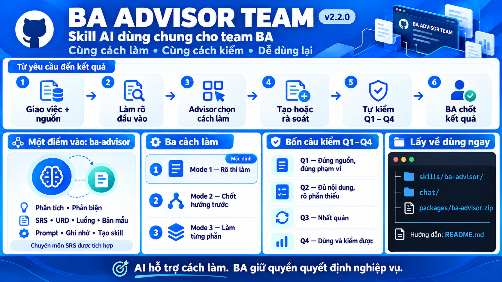

# BA Advisor



**Nói việc cần làm → gửi nguồn → AI làm và tự kiểm → BA chốt → lưu đúng việc để dùng tiếp.**

Skill dùng chung cho Business Analyst. Cài vào dự án, mọi yêu cầu đi qua **ba-advisor**: AI làm việc như một người dùng AI thành thạo thay bạn, đọc đúng nguồn, hỏi đúng chỗ thiếu kèm đáp án đề xuất, tách chỗ cần đúng ý với chỗ được sáng tạo, trả đầu ra sạch để dán thẳng vào tài liệu, tự kiểm Q1–Q4 và ghi nhớ góp ý qua hồ sơ dự án.

**v2.2.0 · Cập nhật 16/10/2026:** giữ đúng bản hiện hành, phạm vi từng việc và cách trình bày BA đã chọn khi sửa hoặc tiếp tục phiên.

Tải về: [Bộ đầy đủ v2.2.0](https://github.com/khoantdse1212/ba-advisor-team/releases/download/v2.2.0/ba-advisor-team-v2.2.0.zip) · [ZIP skill v2.2.0 cho Claude](https://github.com/khoantdse1212/ba-advisor-team/releases/download/v2.2.0/ba-advisor.zip) · [Thông tin phát hành v2.2.0](https://github.com/khoantdse1212/ba-advisor-team/releases/tag/v2.2.0).

Bản cập nhật nằm trên nhánh `main` và hai ZIP đính kèm release. Tag `v2.2.0` cùng mục “Source code” tự sinh vẫn là mốc phát hành ban đầu; dùng các ZIP phía trên để nhận nội dung cập nhật. Khi thiết lập, ghi thêm commit hoặc ngày cập nhật để phân biệt các bản cùng số phiên bản.

## Thiết lập

Mở công cụ AI trong thư mục dự án và gửi:

```text
Giúp tôi thiết lập skill ba-advisor từ https://github.com/khoantdse1212/ba-advisor-team cho dự án này theo README của repo. Giữ cấu hình hiện có, hỏi khi cần chọn thư mục hoặc cấp quyền, rồi hướng dẫn tôi thử một việc nhỏ bằng dữ liệu được phép.
```

**Các bước công cụ AI thực hiện:**

1. Dùng ZIP hoặc thư mục người dùng đưa nếu có; khi tải từ GitHub, lấy mọi tệp từ cùng một commit hoặc bản phát hành. Đọc README này và `skills/ba-advisor/SKILL.md`.
2. Đặt skill theo nền tảng, ưu tiên phạm vi dự án:

   | Nền tảng | Cách đặt |
   |---|---|
   | Codex | Chép thư mục `skills/ba-advisor` vào `.agents/skills/ba-advisor/` của dự án |
   | Antigravity | Chép vào `.agents/skills/ba-advisor/` của workspace; đối chiếu hướng dẫn của bản Antigravity đang dùng |
   | Claude Code | Chép vào `.claude/skills/ba-advisor/` của dự án |
   | Claude có Skills (ứng dụng Claude, Cowork) | Người dùng tải lên `packages/ba-advisor.zip` qua chức năng thêm skill rồi bật |
   | Công cụ chưa hỗ trợ skill (ví dụ giao diện chat chạy cục bộ) | Gửi `chat/BA-ADVISOR-CHAT.md` đầu phiên; việc SRS, URD dùng `chat/BA-SRS-CHAT.md`. Chọn một cách nạp |

3. Nơi đặt đã có `ba-advisor`: giống hệt thì dùng lại; khác thì báo khác biệt và chờ người dùng chọn. Bản cũ (kể cả thư mục `ba-srs` của bản 1.x) được sao lưu ra ngoài thư mục tự nạp trước khi thay.
4. Thêm vào tệp chỉ dẫn dự án mà công cụ đọc (`AGENTS.md` với Codex, `CLAUDE.md` với Claude Code; tạo tệp nếu chưa có) dòng: `Với mọi yêu cầu trong dự án này, dùng skill ba-advisor.`
5. Báo người dùng: nguồn và phiên bản (dòng tiêu đề của `SKILL.md`), nơi đặt, kết quả một lượt thử nạp, các bước người dùng còn làm (mở phiên mới, cấp quyền, tải ZIP).

Máy chặn kết nối Internet: tải ZIP ở máy được phép rồi chép theo bước 2–4. Tài liệu nền tảng: [Codex](https://learn.chatgpt.com/docs/build-skills), [Claude Code](https://code.claude.com/docs/en/skills), [Antigravity](https://antigravity.google/docs/skills), [Claude](https://support.claude.com/en/articles/12512180-use-skills-in-claude).

## Bảo mật dữ liệu

Chưa có xác nhận môi trường: dùng dữ liệu giả, bản đã làm sạch được đơn vị cho phép, hoặc tư vấn chung. Dữ liệu dự án thật dùng trong môi trường AI chạy hoàn toàn trên máy cục bộ, chặn kết nối ra, đã được người phụ trách kỹ thuật xác nhận. Codex, Claude Code, Antigravity và Claude mặc định gọi mô hình trên đám mây nên cần được cấu hình và xác nhận trước khi nhận dữ liệu thật. Cách làm sạch tài liệu, checklist kỹ thuật và mẫu xác nhận: [bao-mat-du-lieu.md](skills/ba-advisor/references/bao-mat-du-lieu.md).

## Cách dùng

Giao việc như nhờ đồng nghiệp: nói việc, gửi nguồn được phép dùng, kèm mẫu đầu ra nếu có.

> Đọc biên bản này, tách điều đã thống nhất, việc cần làm và câu hỏi để trao đổi với khách hàng.
>
> Đặc tả chức năng này theo mẫu dự án tôi gửi để Dev và Tester dùng.
>
> Cập nhật bản 0.1 theo CR: tên vùng tăng lên 150 ký tự.

Thêm "mode 2" để chọn hướng trước, "mode 3" để làm và duyệt từng phần.

| Gõ | Kết quả |
|---|---|
| `chốt` | Chốt phần hiện tại, sang phần tiếp |
| `sửa: …` | Sửa đúng chỗ, kiểm phần phụ thuộc, báo đã đổi gì |
| `ghi nhớ: …` | Lưu quy tắc đúng phạm vi: riêng một việc hoặc dùng chung trong dự án |
| `kiểm` | Kiểm Q1–Q4 tài liệu đang làm hoặc được gửi |
| `làm tiếp A` | Đọc ghi chú và bản hiện hành của việc A; thiếu tên việc mà có nhiều khả năng thì hỏi |
| `gọn` | Rút phần ghi chú, giữ nội dung bàn giao |

Mỗi câu trả lời có hai phần: **Nội dung bàn giao** để dán vào tài liệu, với các dấu [Cần xác nhận], [Mâu thuẫn], [Đề xuất]; và **Ghi chú cho BA** gồm câu hỏi, kết quả tự kiểm, thao tác đã làm. BA đối chiếu bằng bốn câu chung và là người xác nhận nội dung bàn giao:

| | Câu kiểm |
|---|---|
| Q1 | Kết quả có đúng tài liệu nguồn và phạm vi được giao không? |
| Q2 | Đã đủ nội dung liên quan và chỉ rõ phần còn thiếu chưa? |
| Q3 | Các phần mô tả, dữ liệu và giao diện có thống nhất không? |
| Q4 | Người nhận có thể dùng kết quả để làm tiếp và kiểm tra được không? |

### Giữ đúng kết quả qua nhiều lần làm

- **Có bản ưng ý:** “Dùng bản A-v1 làm mốc; giữ cấu trúc và mức chi tiết này khi sửa tiếp.” Nói rõ phần đã chọn, không cần soạn prompt dài.
- **Giao sửa:** “Sửa thời hạn theo CR này.” AI đọc đúng bản, sửa phần liên quan và đối chiếu phần cần giữ; nguồn được xác nhận mới vẫn có thể thay nghiệp vụ cũ.
- **Đổi việc hoặc phiên:** “Lưu ghi chú việc A để tôi làm tiếp sau.” Hồ sơ chung dẫn tới từng việc; ghi chú giữ bản hiện hành, quyết định, phần đã kiểm và bước tiếp theo. Phiên mới nói “Làm tiếp A”.

Nếu công cụ chỉ hỗ trợ chat, lưu rồi gửi lại ghi chú cùng bản hiện hành và nguồn liên quan. Skill giúp AI khôi phục từ hồ sơ được đọc; không bảo đảm nền tảng nhớ toàn bộ lịch sử. Chọn bản làm mốc trình bày không đồng nghĩa duyệt toàn bộ nghiệp vụ.

## Thử ngay

Gửi câu "Chuẩn bị nội dung trao đổi với khách hàng: điều đã thống nhất, ai làm gì, câu cần hỏi" kèm biên bản giả lập sau:

```text
SRC-M1 — Trao đổi danh sách vùng (dữ liệu giả lập, 13/10/2026)
- Người sử dụng muốn xuất danh sách vùng ra Excel để kiểm tra trước buổi đối soát; chưa thống nhất xuất toàn bộ hay chỉ các dòng đang lọc.
- Phương, phụ trách trao đổi với người sử dụng, gửi mẫu các cột cần xuất ngày 16/10/2026.
- Nam (Dev) cho biết hệ thống đã có danh sách và bộ lọc; chưa xác nhận có API xuất Excel.
- Nhóm thống nhất đợt này chưa làm chức năng nhập dữ liệu từ Excel.
- Người sử dụng nêu "khoảng 5.000 dòng"; chưa rõ là giới hạn hay ví dụ khối lượng.
- Mai tổng hợp câu hỏi còn mở. Ghi chép có câu "chốt trước thứ Sáu", chưa rõ hạn của việc nào.
```

Kết quả tốt có: điều đã thống nhất (chưa làm nhập Excel); việc Phương gửi mẫu cột ngày 16/10/2026; việc Mai tổng hợp câu hỏi với hạn chưa xác định; câu hỏi về phạm vi xuất, API, ý nghĩa của 5.000 dòng và việc nào cần "chốt trước thứ Sáu". Phần bàn giao gọn, đủ để gửi khách hàng.

## Thư mục dự án

```text
du-an/
├── HO-SO-DU-AN.md    nguồn, mẫu, quy tắc chung và đường dẫn tới từng việc
├── nguon/            tài liệu đầu vào, giữ bản gốc
└── ket-qua/<viec>/   đầu ra và ghi chú làm tiếp của từng việc
```

Hồ sơ dự án và xác nhận môi trường lưu tại máy, tách khỏi repo phân phối skill.

## Trong repo

| Thư mục, tệp | Nội dung |
|---|---|
| `skills/ba-advisor/` | Bản cài: `SKILL.md`; `references/srs.md` (SRS, URD, luồng, bản mẫu, mẫu Word); `references/tao-skill.md` (tạo skill mới); `references/bao-mat-du-lieu.md` (làm sạch, checklist, mẫu xác nhận); `assets/HO-SO-DU-AN.md`; `agents/openai.yaml` |
| `packages/ba-advisor.zip` | Gói tải lên ứng dụng Claude có Skills |
| `chat/` | Bản gộp cho công cụ chưa hỗ trợ thư mục skill |
| `CHANGELOG.md` | Lịch sử thay đổi theo loại góp ý |

Phiên bản **v2.2.0** · Cập nhật 16/10/2026 · Giấy phép MIT.
