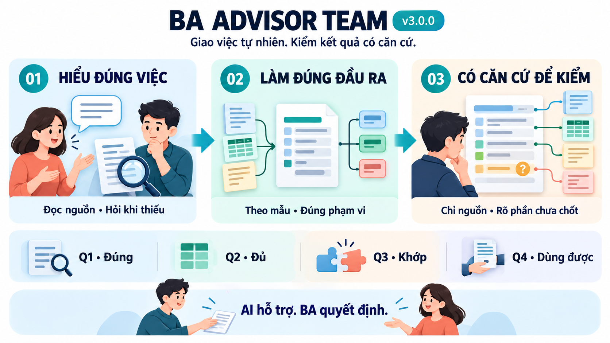

# BA Advisor Team



**Giao việc như nhờ đồng nghiệp. AI làm đúng nguồn; BA có căn cứ để kiểm.**

Bộ hướng dẫn tiếng Việt dùng chung cho team BA, đóng gói thành **plugin Codex cài một lần** hoặc skill/tệp chat cho nền tảng khác. `ba-advisor` hỗ trợ công việc hằng ngày; `ba-setup` giúp bắt đầu sau khi cài. Mục tiêu chính là đầu ra giữa các BA có **cách kiểm và chất lượng nhất quán hơn**, không phải tạo nhiều tài liệu hay giao hết quyết định cho AI.

**v3.1.0 · 01/11/2026** — thêm plugin, thiết lập ban đầu và chọn công cụ theo khả năng thực có. Hình trên minh họa nguyên lý giữ lại từ v3.0.

[Tải plugin](https://github.com/khoantdse1212/ba-advisor-team/releases/download/v3.1.0/ba-advisor-team-plugin.zip) · [Bộ đầy đủ](https://github.com/khoantdse1212/ba-advisor-team/releases/download/v3.1.0/ba-advisor-team-v3.1.0.zip) · [ZIP skill riêng](https://github.com/khoantdse1212/ba-advisor-team/releases/download/v3.1.0/ba-advisor.zip) · [Bản phát hành](https://github.com/khoantdse1212/ba-advisor-team/releases/tag/v3.1.0) · [Lịch sử](CHANGELOG.md)

## Cài một lần trong Codex

Với Codex có lệnh `plugin`, mở Terminal và chạy hai dòng sau **một lần cho mỗi máy/tài khoản Codex**:

```bash
codex plugin marketplace add khoantdse1212/ba-advisor-team --ref v3.1.0
codex plugin add ba-advisor-team@ba-advisor-team
```

Sau đó mở phiên mới. Trong danh sách plugin chọn **BA Advisor Team**, chạy Setup nếu giao diện có nút này; hoặc chọn skill **ba-setup** thuộc plugin và nói:

```text
Giúp tôi bắt đầu một việc nhỏ bằng BA Advisor.
Dùng kết nối tôi đang có, giữ hồ sơ và cấu hình hiện tại.
Chưa có nguồn dự án thì dùng dữ liệu giả để thử.
```

Hằng ngày chọn **BA Advisor** thuộc plugin rồi giao việc bằng lời thường; không cần gửi lại bộ hướng dẫn hoặc setup lại mỗi chat. Việc mới vẫn cần chỉ đúng nguồn/hồ sơ. Plugin không tự nhớ tất cả phiên và không bảo đảm luôn tự được chọn; nếu chưa thấy nó hoạt động, chọn đích danh trong danh sách skill/plugin.

Không quen Terminal: gửi AI có quyền thao tác máy đoạn dưới để cài giúp. Nếu máy không nhận lệnh `codex`, dùng bản Codex hỗ trợ plugin hoặc cách skill riêng ở phần sau; không sửa đường dẫn hệ thống bằng phỏng đoán.

```text
Cài plugin BA Advisor Team từ khoantdse1212/ba-advisor-team,
ghim bản v3.1.0 theo README. Giữ các plugin và cấu hình khác.
Nếu có ba-advisor cũ, chỉ rõ bản đang dùng và khác biệt,
không xóa/ghi đè bản tùy chỉnh. Kiểm tra cài thành công rồi hướng dẫn tôi mở phiên mới.
```

**Cài plugin ≠ kết nối tài khoản.** Plugin này gói cách làm và chọn công cụ; không chứa MCP server riêng, không tự đăng nhập Drive/Figma và không tự tăng quyền. Advisor tìm khả năng host đang cung cấp, chỉ dùng kết nối cần cho việc được giao. Thiếu thì hướng dẫn bổ sung hoặc làm phần độc lập trước. Các tài khoản cần đăng nhập/cấp quyền riêng khi nền tảng yêu cầu. Điều kiện dữ liệu dự án ở dưới vẫn áp dụng.

Đây là **danh mục cài từ repo của nhóm**, chưa phải chứng nhận hoặc niêm yết trong kho plugin công khai của OpenAI. Cách đóng gói theo [hướng dẫn plugin Codex](https://developers.openai.com/plugins/build/plugins); phạm vi chạy đã kiểm ở [kết quả v3.1](evals/RESULTS-v3.1.0.md).

## Repo giúp gì trong việc thật?

| Bạn giao việc | Advisor giúp làm | Bạn vẫn quyết định/kiểm |
|---|---|---|
| “Đọc biên bản, chuẩn bị nội dung trao đổi khách hàng” | Tách điều đã thống nhất, đề nghị, việc và câu hỏi; không ép viết SRS | Ý nào thật sự được xác nhận, ai làm gì |
| “Dev hỏi trường này có bắt buộc không?” | Tìm đúng nguồn; trả phần rõ và chỉ ra điểm thiếu/mâu thuẫn | Quy tắc chưa được chốt |
| “Sửa SRS theo CR này” | Sửa đúng bản/phần, giữ nội dung khác, chỉ vị trí ảnh hưởng | Nội dung thay đổi và tài liệu liên quan còn chưa sửa |
| “Giúp tôi làm rõ, dựng bản thử rồi thiết kế” | Chọn công đoạn, skill/công cụ cần cho đầu ra; thiếu quyền thì báo rõ | Phạm vi, lựa chọn quan trọng, quyền sửa thiết kế |
| “Làm tiếp việc X” | Đọc ghi chú, nguồn và bản hiện hành của X | Đúng việc, đúng bản; không lấy dữ kiện việc khác |

**Lời giao việc + nguồn → hiểu đích đến → làm vừa đủ → kiểm Q1–Q4 → BA quyết định.**

Skill không tự mở được mọi hệ thống, không tự nhớ mọi phiên và không bảo đảm AI luôn đúng. Kết quả phụ thuộc nguồn, model, công cụ và việc BA kiểm. BMAD là lựa chọn khi có ích; SRS là một phần chuyên môn, không phải đầu ra mặc định.

## Bắt đầu trong một việc nhỏ

### 1. Nếu đã cài plugin, chuyển sang bước 2; nền tảng khác chọn cách nạp

- **Công cụ có thư mục skill:** tải bộ đầy đủ, lấy nguyên thư mục `skills/ba-advisor/`, gồm cả references và assets. Đặt theo bảng bên dưới.
- **Claude có chức năng tải Skills:** tải `ba-advisor.zip` ở release, thêm qua chức năng quản lý Skills và bật. Không tải ZIP toàn repo vào ô cài một skill.
- **Chat chỉ nhận tệp:** đính kèm [BA-ADVISOR-CHAT.md](chat/BA-ADVISOR-CHAT.md) và nói “Dùng hướng dẫn trong tệp này cho công việc tôi giao”. Việc chuyên về SRS có thể dùng [BA-SRS-CHAT.md](chat/BA-SRS-CHAT.md) thay thế. Chọn **một** bản; phần chuyên môn chưa được gộp thì gửi thêm khi AI cần.

| Nền tảng | Thư mục skill theo dự án |
|---|---|
| Codex | `.agents/skills/ba-advisor/` |
| Claude Code | `.claude/skills/ba-advisor/` |
| Antigravity | `.agents/skills/ba-advisor/`; đối chiếu tài liệu bản đang dùng |

Trong công cụ có thể thao tác tệp, bạn cũng có thể gửi:

```text
Giúp tôi thiết lập skill riêng ba-advisor v3.1.0 từ repo
https://github.com/khoantdse1212/ba-advisor-team cho dự án này theo README.
Giữ cấu hình hiện có, dùng tất cả tệp từ cùng bản phát hành.
Nếu có skill cũ khác nội dung, báo khác biệt trước khi thay;
sao lưu bản cũ ra ngoài thư mục tự nạp. Sau đó thử một việc nhỏ với dữ liệu giả.
```

**Cho công cụ thực hiện thiết lập:** đọc README và `SKILL.md`, dùng nguồn người dùng cung cấp trước. Chỉ thêm dòng “Với việc BA trong dự án này, dùng skill ba-advisor” vào tệp chỉ dẫn phù hợp nếu người dùng chọn dùng theo dự án; giữ phần cấu hình khác. Báo phiên bản, nguồn, nơi đặt và kết quả thử nạp; không nói đã cài khi mới hướng dẫn. Nếu nền tảng chưa nạp thì mở phiên mới theo hướng dẫn của nền tảng. Không có quyền thì nêu bước người dùng phải làm.

Tài liệu nền tảng: [Codex](https://learn.chatgpt.com/docs/build-skills), [Claude Code](https://code.claude.com/docs/en/skills), [Antigravity](https://antigravity.google/docs/skills), [Claude Skills](https://support.claude.com/en/articles/12512180-use-skills-in-claude). Cấu trúc portable không đồng nghĩa mọi nền tảng/model đã được kiểm chứng.

### 2. Giao việc bằng lời thường

```text
Dữ liệu giả lập: nhóm thống nhất đợt này chỉ xuất Excel, chưa làm nhập.
Mai gửi mẫu cột ngày 27/10. Chưa chốt xuất toàn bộ hay theo bộ lọc.
Dev đề nghị tự loại trùng, chưa được xác nhận.
Giúp tôi soạn tin nhắn ngắn: điều đã thống nhất, việc cần làm và câu cần hỏi.
```

AI cần trả nội dung dùng được ngay, giữ “loại trùng” ở trạng thái đề nghị, không tự viết SRS hoặc bắt bạn trả lời tất cả câu hỏi trước khi tổng hợp. Muốn thử việc khó hơn: [bộ ca dùng thử](evals/README.md).

### 3. Kiểm bằng bốn câu chung

| | BA tự hỏi |
|---|---|
| **Q1 — Đúng** | Có đúng nguồn và phạm vi giao không? |
| **Q2 — Đủ** | Đủ nội dung liên quan, chỉ rõ chỗ thiếu chưa? |
| **Q3 — Khớp** | Các phần có thống nhất; sửa rồi có làm lệch phần khác không? |
| **Q4 — Dùng được** | Người nhận có thể làm tiếp và kiểm kết quả không? |

AI tự kiểm giúp BA tập trung vào vị trí cần xem, không thay BA phê duyệt. “Đã tạo tệp”, “đã đối chiếu nội dung”, “đã chạy thử” và “BA đã chấp nhận” là các việc khác nhau. SRS/đầu ra lớn mặc định có bảng kiểm kèm bằng chứng; câu trả lời nhỏ không bị ép mẫu báo cáo. Cấu hình cá nhân yêu cầu không bảng/checklist có thể đổi cách trình bày; khi cần cùng một hình thức soát trong team, nói rõ **“Kèm bảng Q1–Q4 và vị trí đối chiếu để tôi kiểm”**. Không cần xóa cấu hình cá nhân.

## Điều khiển nhịp làm, không cần học lệnh

**mode 1** mặc định: rõ thì làm. **mode 2**: chọn hướng trước. **mode 3**: từng phần, bạn chốt rồi đi tiếp. Giữ mode khi tiếp tục cùng việc; không ép menu nếu đã giao rõ.

Bạn có thể nói: `sửa: …`, `kiểm bản này`, `làm tiếp X`, `gọn phần giải thích`. `Chốt` cho đi tiếp phần đang xét, không tự đổi tài liệu thành Đã duyệt. `Tự quyết/làm luôn` cho AI xử lý phần được giao, không biến nghiệp vụ chưa biết thành sự thật.

Với SRS, ưu tiên **mẫu dự án**. Nếu chưa có mẫu, dùng bốn phần kèm sẵn: **Mô tả tóm tắt → Yêu cầu giao diện → Mô tả trường thông tin → Các tình huống sử dụng**; đủ hình, chú thích, bảng theo từng màn hình và từng trường. Không buộc dùng mẫu này cho mọi công việc.

## Giữ kết quả để dùng tiếp

Chọn bản tốt làm mốc: “Giữ cấu trúc và mức chi tiết của bản X-v1”. Khi cần làm nhiều phiên, giao “Lưu ghi chú việc X để tôi tiếp tục sau”. Dùng thư mục hiện có; với dự án mới có thể tổ chức:

```text
du-an/
├── HO-SO-DU-AN.md       chỉ mục nguồn, quy ước và các việc đang mở
├── nguon/               bản nguồn giữ nguyên
└── ket-qua/<viec>/      đầu ra và một ghi chú làm tiếp cho việc đó
```

Ghi chú giữ bản hiện hành, mode, quyết định, câu hỏi mở và bước tiếp; dẫn tới nguồn, không sao chép thành sổ thứ hai. Phiên mới đọc lại ghi chú và nguồn liên quan. Nếu chỉ có chat, lưu và gửi lại các tệp đó. Việc làm một lần không bắt tạo hồ sơ.

Muốn dùng lại một cách làm chuyên môn: giao advisor tạo skill từ mẫu, ví dụ tốt và lỗi thường phải sửa. Advisor sẽ phân biệt điều nên lưu riêng task, quy ước dự án hay skill dùng lại; không tự sinh thêm skill mỗi khi gặp việc lặp.

## Dữ liệu nào được dùng?

Repo public chỉ chứa hướng dẫn, mẫu rỗng và ca giả lập. **Dữ liệu dự án thật chỉ dùng trong môi trường xử lý hoàn toàn trên máy, chặn kết nối ra và có xác nhận kỹ thuật còn hiệu lực; không dùng để huấn luyện/tinh chỉnh.** Lưu tệp local hoặc tắt huấn luyện chưa đủ đáp ứng điều kiện này.

Chưa xác nhận thì dùng dữ liệu giả, bản đã làm sạch được đơn vị cho phép hoặc tư vấn chung. Làm sạch bản gốc trong môi trường được phép trước khi đưa vào AI bên ngoài. Skill không cấu hình hoặc chứng nhận bảo mật: xem [điều kiện và mẫu xác nhận](skills/ba-advisor/references/bao-mat-du-lieu.md). Không đưa hồ sơ dự án vào repo; `.gitignore` chỉ hỗ trợ, không tự bảo vệ mọi tệp.

## Người dùng cần phần nào trong repo?

| Phần | Mục đích |
|---|---|
| `skills/ba-advisor/` | Skill cài đặt: lõi cộng tác và tài liệu chuyên môn chỉ đọc khi cần |
| `skills/ba-setup/` | Hướng dẫn thiết lập lần đầu, dùng lại hồ sơ và công cụ đang có |
| `.codex-plugin/`, `.agents/plugins/` | Khai báo plugin và danh mục cài từ repo |
| `plugins/ba-advisor-team/` | Bản cài sinh từ nguồn; chỉ chứa nội dung cần chạy, không sửa tay |
| `chat/` | Bản gộp sinh từ nguồn, cho công cụ chỉ nhận tệp |
| `packages/ba-advisor.zip` | Một skill đóng gói, cùng nội dung với thư mục skill |
| `packages/ba-advisor-team-plugin.zip` | Plugin gọn để phân phối; không gồm bộ thử, chat hoặc dữ liệu dự án |
| `evals/` | Ca giả lập và phiếu kiểm cho người đánh giá; **không cài vào skill** |
| `scripts/`, `tests/` | Người quản lý kiểm cấu trúc, đồng bộ chat và đóng gói; BA dùng hằng ngày không cần chạy |
| `CHANGELOG.md`, `LICENSE` | Lịch sử và giấy phép MIT |

### Nâng từ v2.2 lên v3

Giữ tên `ba-advisor`, Q1–Q4, ba mode, điều kiện dữ liệu và mẫu SRS A/B/C/D. Không cần chuyển hồ sơ sang cấu trúc mới. Bỏ tầng nhãn “Đúng ý/Sáng tạo/Lai”; giữ phân biệt căn cứ/đề xuất tại nội dung. Thay nguyên thư mục skill sau khi so và sao lưu tùy chỉnh; chỉ nạp một phiên bản. Không tự cập nhật tất cả máy trong team.

v3 dùng tag, mã nguồn và ZIP từ cùng một commit phát hành; không ghi đè tài sản release cũ. v2.2.0 và lịch sử vẫn được giữ để đối chiếu/quay lại. Hai hình overview cũ trong repo là tư liệu lịch sử, không phải sơ đồ tính năng v3.

### Từ skill v3.0 sang plugin v3.1

Hồ sơ, mẫu và đầu ra cũ giữ nguyên. Cài plugin theo hướng dẫn trên, chọn đúng Advisor thuộc plugin để thử. Nếu từng cài skill riêng có cùng tên, so khác biệt trước; chỉ chuyển bản cũ ra ngoài thư mục tự nạp khi bạn quyết định dùng plugin thay thế. Không trộn hai phiên bản để đánh giá kết quả.

Bản cài được ghim theo tag để cả team dùng cùng nguồn. Khi nhóm chọn bản mới, chạy lại lệnh thêm marketplace với tag mới, sau đó `codex plugin add ba-advisor-team@ba-advisor-team` và kiểm phiên bản. Refresh marketplace đang ghim tag không tự nâng lên tag khác; cài một lần không đồng nghĩa tự cập nhật mọi máy. `codex plugin list --marketplace ba-advisor-team --json` giúp kiểm trạng thái; xem cả manifest phiên bản và thử gọi skill nếu cần xác nhận bản nạp.

### Dành cho người quản lý

```bash
python3 scripts/release.py build
python3 scripts/release.py check
python3 -m unittest discover -s tests -v
```

Python 3, không cài thư viện ngoài. `build` sinh chat, thư mục cài plugin, ZIP plugin/skill, bộ đầy đủ và SHA256 trong `dist/`; `check` không sửa tệp. Sửa nguồn trong `skills/` và manifest tại `.codex-plugin/plugin.json`, không sửa `plugins/`, chat hoặc ZIP bằng tay. Đóng gói theo danh sách cho phép, không gom cả workspace. Kiểm cấu trúc/ZIP không chứng minh hành vi AI; xem [cách thử](evals/README.md), [kết quả v3.0](evals/RESULTS-v3.0.0.md) và [kết quả v3.1](evals/RESULTS-v3.1.0.md).

Góp ý nên kèm lời giao việc, nguồn giả/làm sạch, kết quả thực tế và điều mong đợi. Sửa đầu ra trước; chỉ sửa skill khi lỗi thuộc cách làm dùng chung. Không gửi dữ liệu khách hàng qua issue public.

### Ý tưởng tham khảo, không phải phụ thuộc bắt buộc

Chọn lọc cách thử skill bằng tình huống từ [Anthropic skill-creator](https://github.com/anthropics/skills/tree/main/skills/skill-creator), quản lý thay đổi từ [OpenSpec](https://github.com/Fission-AI/OpenSpec), điều chỉnh cách làm theo task từ [Spec Kit](https://github.com/github/spec-kit), và yêu cầu bằng chứng trước kết luận từ [Superpowers](https://github.com/obra/superpowers/blob/main/skills/verification-before-completion/SKILL.md). Đây là cách áp dụng do repo này biên soạn; không tích hợp hay yêu cầu cài các framework trên.
